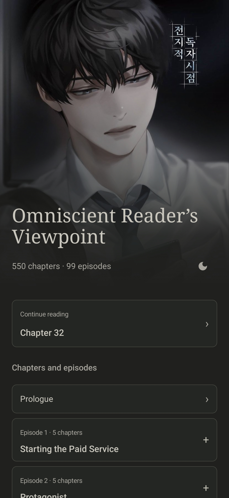
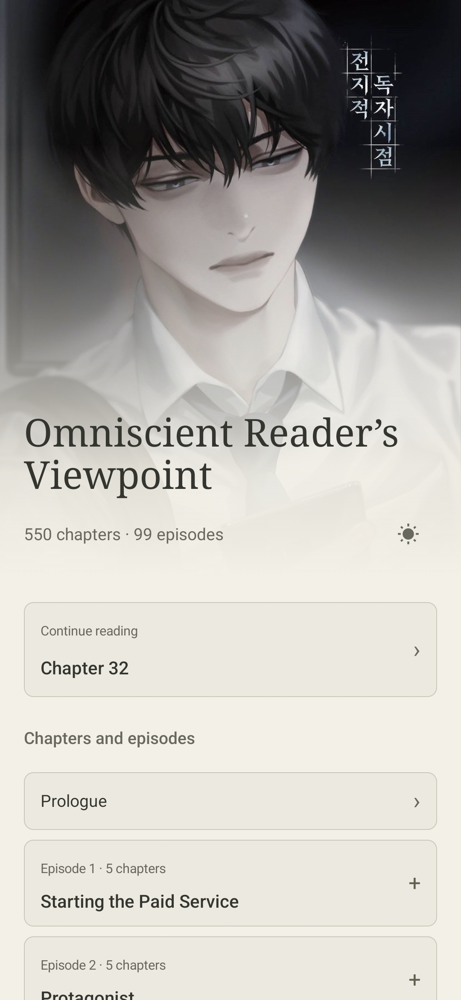
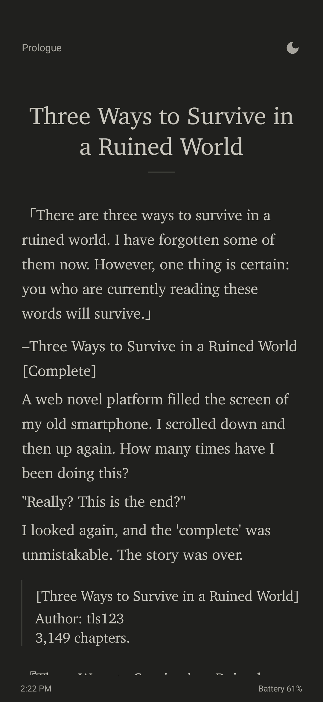
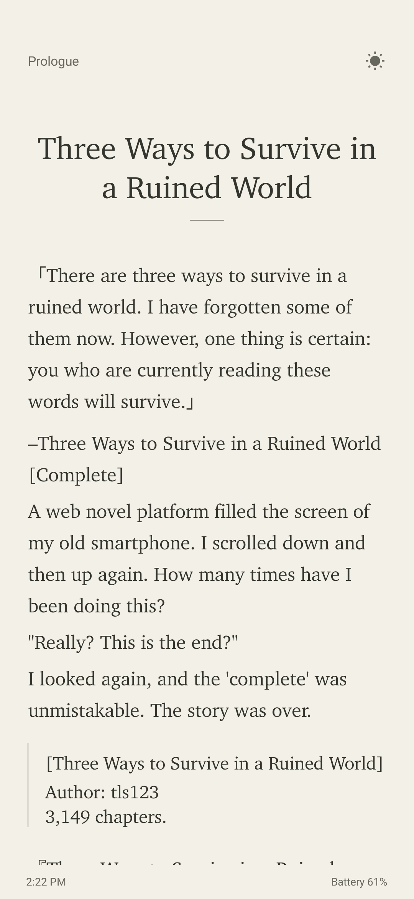

<div align="center">

# ORV

**Omniscient Reader’s Viewpoint, one chapter at a time.**

A quiet Android reading app with an illustrated library, soft colors, and typography made for long chapters.

[](https://github.com/jakubaszcz/ORV/releases/latest)
[](https://github.com/jakubaszcz/ORV/releases)
[](https://github.com/jakubaszcz/ORV/stargazers)
[](#installation)

**[Download the APK](https://github.com/jakubaszcz/ORV/releases/latest/download/orv-archives.apk)** · **[Release notes](https://github.com/jakubaszcz/ORV/releases/latest)** · **[Report an issue](https://github.com/jakubaszcz/ORV/issues)**

</div>

## A library with a little atmosphere

Browse the prologue, expand an episode, or pick up at your saved paragraph. The illustrated header fades into the library, leaving the chapters easy to find.

<table>
  <tr>
    <th>Library · Dark</th>
    <th>Library · Light</th>
  </tr>
  <tr>
    <td align="center"></td>
    <td align="center"></td>
  </tr>
</table>

## Made for reading

- **Offline chapters:** the prologue and 550 numbered chapters are bundled with the app.
- **Episode navigation:** expandable groups keep the chapter list organized.
- **Charter typography:** generous line spacing and a restrained layout keep the focus on the novel.
- **Dark, Light, and System:** switch between charcoal and ivory, or follow your phone’s appearance.
- **A saved reading position:** double-tap a paragraph, then return through **Continue reading**.
- **Gesture navigation:** move between chapters with a pull-and-hold gesture and a circular progress indicator.
- **Full-screen reading:** a small footer keeps the current time and battery level visible.

<table>
  <tr>
    <th>Reader · Dark</th>
    <th>Reader · Light</th>
  </tr>
  <tr>
    <td align="center"></td>
    <td align="center"></td>
  </tr>
</table>

> [!NOTE]
> This is an unofficial fan-made app. The included English translation is also unofficial and may contain inaccuracies or differ from officially published editions. Neither the app nor the translation is affiliated with or endorsed by the original authors or official publishers.

## Installation

Requires **Android 7.0 (API 24) or newer**.

1. Open the [latest release](https://github.com/jakubaszcz/ORV/releases/latest) on your Android phone.
2. Under **Assets**, download **`orv-archives.apk`**. The source-code ZIP and TAR archives are for development, not installation.
3. Open the downloaded APK. If Android asks, allow your browser or file manager to **install unknown apps**, then return to the installer.
4. Tap **Install**, open **ORV**, and choose a chapter. No account or chapter download is needed.

To update, install the newer APK over the existing app. Keep the existing installation to retain your saved position and appearance preference; uninstalling or clearing app storage removes local data. An in-place update requires a matching signing key.

## How to use

| What you want to do | How to do it |
| --- | --- |
| Start reading | Tap **Prologue**, or expand an episode and select a chapter. |
| Save your place | **Double-tap a paragraph.** A short vibration confirms a successful save when haptics are available. |
| Resume reading | Tap **Continue reading** in the library. |
| Read the next chapter | At the bottom, pull upward beyond the end and keep your finger down until the circle fills. |
| Read the previous chapter | At the top, pull downward beyond the beginning and hold until the circle fills. |
| Cancel a chapter change | Release your finger before the circle finishes. |
| Return to the library | Swipe horizontally left or right, or use Android’s Back action. |
| Change appearance | Tap the appearance icon in the library or reader: **Dark → Light → System → Dark**. |

> [!TIP]
> Save your place before leaving a reading session. Scrolling alone does not save your progress; a double-tap replaces the previous saved position.

The appearance icon shows the selected mode: a moon for Dark, a sun for Light, and a computer for System. System follows the phone’s setting, so switching to it may not visibly change the colors.

## Build from source

Open the project in an Android Studio version compatible with the Android Gradle Plugin declared in [`gradle/libs.versions.toml`](gradle/libs.versions.toml). Install **Android SDK Platform 37** and use a Gradle JDK compatible with the project’s bundled Gradle wrapper and Android Gradle Plugin. Allow Android Studio to finish the initial dependency sync.

```sh
git clone https://github.com/jakubaszcz/ORV.git
cd ORV
```

Build a debug APK on Windows (PowerShell):

```powershell
.\gradlew.bat :app:assembleDebug
```

On macOS or Linux:

```sh
chmod +x gradlew
./gradlew :app:assembleDebug
```

The APK is written to `app/build/outputs/apk/debug/app-debug.apk`. You can also select a device or emulator in Android Studio and click **Run**.

The app uses **Kotlin**, **Jetpack Compose**, **Material 3**, and **Preferences DataStore**. Chapter data and the episode manifest live in [`app/src/main/assets/chapters`](app/src/main/assets/chapters).

## Feedback

Found a reading or navigation issue? [Open an issue](https://github.com/jakubaszcz/ORV/issues) with your Android version, app version, and steps to reproduce it. For chapter-specific problems, include the chapter number.

If the app makes your reading sessions a little nicer, a star is appreciated.

<details>
<summary>About the badges</summary>

The badges are served by [Shields.io](https://shields.io/) and update from GitHub. Downloads count release-asset downloads across all releases, not unique readers, installations, or source-code clones. Values may take a little time to refresh.

</details>

## Credits

An unofficial fan-made reader for *Omniscient Reader’s Viewpoint*. The novel, translation, artwork, and logos belong to their respective rights holders; this project is not an official release.

Reading typography uses **Bitstream Charter**. Its bundled notice is available in [`app/src/main/assets/licenses/charter.txt`](app/src/main/assets/licenses/charter.txt).
